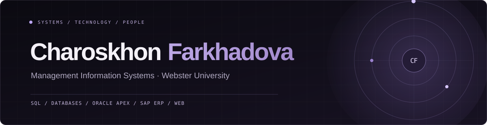

<p align="center">
  <a href="https://requiembby.github.io/responsive-developer-portfolio/"><strong>Explore my portfolio ↗</strong></a>
  &nbsp;&nbsp;·&nbsp;&nbsp;
  <a href="https://www.linkedin.com/in/charoskhon-farkhadova-2148a9307/">LinkedIn</a>
  &nbsp;&nbsp;·&nbsp;&nbsp;
  <a href="mailto:farkhadova.charos@gmail.com">Email</a>
</p>

---

### About

I'm **Charoskhon**, a senior **Management Information Systems student at Webster University in Tashkent**. I'm interested in how well-designed data systems, useful software, and thoughtful business processes come together.

My academic work includes **SQL/MySQL**, **Oracle APEX**, **SAP S/4HANA** course exercises, and systems analysis. I'm also developing practical portfolio demonstrations in **web development** and **applied cryptography**. My background in business development and marketing brings an additional perspective on communication and business needs.

I'm exploring **entry-level opportunities and internships** in data, business analysis, and enterprise technology.

### Selected work

| Project | Focus | Type |
|:--|:--|:--|
| **[Online Shopping Database](https://github.com/requiembby/online-shopping-database)** | MySQL, relational schema design, normalization, stored procedures, triggers | University SQL project |
| **[Oracle APEX Shopping System](https://github.com/requiembby/oracle-apex-shopping-system)** | Forms, interactive reports, inventory grid, charts | University application case study |
| **[Student Management Application](https://github.com/requiembby/student-management-oracle-apex)** | Data entry, CRUD workflows, student reports and charts | University application case study |
| **[SAP S/4HANA ERP Case Studies](https://github.com/requiembby/sap-s4hana-erp-case-studies)** | Production planning, inventory transfer, SAP navigation | University coursework |
| **[RSA Cryptography & OpenSSL](https://github.com/requiembby/rsa-cryptography-openssl)** | RSA-OAEP encryption, RSA-PSS signatures, Bash | Reproducible portfolio demonstration |
| **[Responsive Developer Portfolio](https://github.com/requiembby/responsive-developer-portfolio)** | HTML5, CSS3, JavaScript, responsive UI | Web portfolio project |

<sub>Projects are labeled according to their actual scope. Some university case studies provide documentation and screenshots rather than runnable application exports. Each repository explains its implementation and limitations.</sub>

### Skills & interests

```text
DATA          SQL · MySQL · Relational Databases · Data Modeling
APPLICATIONS  Oracle APEX · HTML5 · CSS3 · JavaScript
ENTERPRISE    SAP S/4HANA Coursework · ERP · Systems Analysis
SECURITY      Cryptography Fundamentals · OpenSSL
PROFESSIONAL  Business Development · Communication · Documentation
```

### Currently focused on

- Strengthening SQL, data modeling, and application development skills through projects.
- Connecting technical coursework with business requirements and processes.
- Exploring junior and trainee opportunities across **Data Analytics**, **Business Analysis**, and **Enterprise IT**.

---

<p align="center">
  <a href="https://requiembby.github.io/responsive-developer-portfolio/"><strong>VIEW THE PORTFOLIO WEBSITE ↗</strong></a>
</p>

<p align="center"><sub>Based in Tashkent, Uzbekistan · Open to early-career IT opportunities</sub></p>
